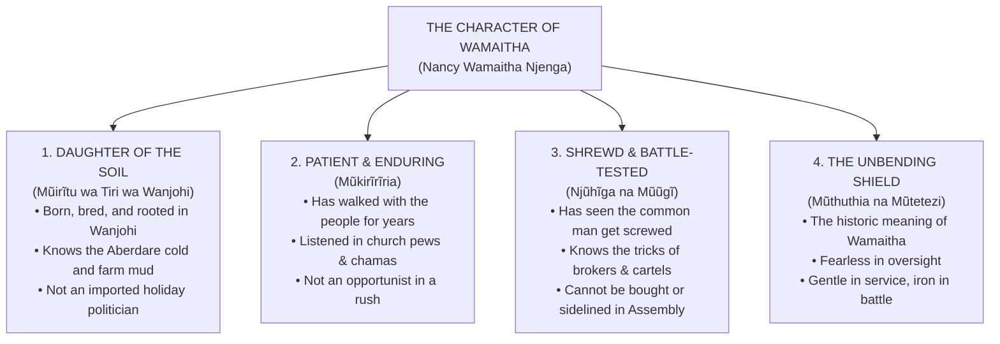

# CAMPAIGN BRAND STRATEGY: THE CHARACTER OF WAMAITHA
## Candidate: Nancy Wamaitha Njenga
### Target Seat: Member of County Assembly (MCA), Wanjohi Ward
### Constituency: Kipipiri | County: Nyandarua, Kenya

---

## 1. Executive Brand Essence: Beyond Slogans

Voters in Wanjohi Ward do not need another plastic, rehearsed politician with foreign buzzwords. They want someone who smells like their soil, understands their silent tears, and has the grit to stand up when the community is cheated.

The political brand **WAMAITHA** is built on four authentic character cornerstones:

---

## 2. The Four Pillars of Her Character

### Pillar 1: Daughter of the Soil (*Mũirĩtu wa Tiri*)
- **The Ground Truth:** Nancy Wamaitha’s feet have trodden the red volcanic clay of Ndemi, Gatondo, Rironi, and Wanjohi since childhood. She does not need a tour guide or a GPS to find our villages.
- **Why It Matters to Voters:** Wanjohi has suffered under leaders who live in distant towns, show up in sleek fuel guzzlers only during elections, and vanish the moment the certificate is issued. Wamaitha is permanently anchored in the soil.
- **Everyday Imagery:** She knows the ache of 5:00 AM milking in the Aberdare frost; she knows the bitter sting of carrying a child on muddy paths when the local dispensary has no Panadol.

### Pillar 2: Patient & Enduring (*Mũkirĩrĩria*)
- **The Ground Truth:** True leadership is not an impulse or a vanity project. Wamaitha has waited, observed, served quietly, and stayed grounded while louder, flashier figures chased titles.
- **Why It Matters to Voters:** Wanjohi residents value emotional maturity. A leader who is patient does not abandon ship when things get tough. She has walked with women's merry-go-rounds, stood by grieving families without cameras, and listened before speaking.
- **Proverbial Anchor:** *"Mũkirĩrĩria ndatũraga arĩ thĩ"* (The patient one will not remain on the ground).

### Pillar 3: Shrewd & Battle-Tested (*Njũhĩga*)
- **The Ground Truth:** Politics in Kenya is not a tea party. The system has repeatedly screwed the Wanjohi potato farmer, the dairy cooperative, and the boda boda youth.
- **Why It Matters to Voters:** Nancy Wamaitha is not naive. She understands the maneuvers of potato brokers who use rigged weighing scales and extended sacks (*bag ya rura*). She understands how budget allocations are hijacked in the County Assembly corridors in Ol Kalou.
- **The Edge:** You cannot dupe her. You cannot intimidate her. You cannot buy her silence with county committee sitting allowances. She is sharp, alert, and relentlessly protective of public funds.

### Pillar 4: The Unbending Shield (*Wamaitha the Defender*)
- **The Heritage:** Historically, *Wamaitha* was a name earned by women who defended the homestead during attacks, who refused to cower when danger knocked, and who held the family together through famine.
- **The Modern Mandate:** Wanjohi needs a defender on the floor of the Nyandarua County Assembly. When budgets are being cut, when road equipment is diverted, when bursaries are cornered by the elite—Wamaitha stands in the gap as the shield of the poor.

---

## 3. Grassroots Slogans & Taglines

### Primary Slogan:
> **"Simama na Wamaitha: Mwĩhoko wa Wanjohi"**  
> *(Stand with Wamaitha: The Real Hope of Wanjohi)*

### The Grassroots Triad:
> **"Witikio • Wĩra • Kĩhooto"**  
> *(Faith • Hard Work • Justice for the People)*

### The Street & Boda Boda Chant:
- **Leader:** *"Mũirĩtu wa Tiri?"* $\rightarrow$ **Crowd:** *"Wamaitha!"*
- **Leader:** *"Mũkirĩrĩria?"* $\rightarrow$ **Crowd:** *"Wamaitha!"*
- **Leader:** *"Wanjohi?"* $\rightarrow$ **Crowd:** *"Kazi na Haki!"*

---

## 4. Ground Reality: Five Grassroots Commitments

1. **Stop Screwing the Potato Farmer (Fair Packaging & Storage):**
   Strict enforcement of the 50kg standard potato bag rule. Establishing ward aggregation holding centers so farmers are not forced to sell at throwaway prices in the mud.
2. **All-Weather Feeder Roads:**
   Channelling county heavy grader machinery to Wanjohi’s impassable agricultural arteries (milk and potatoes must move to market regardless of weather).
3. **Public, Uncompromised Bursaries:**
   Publishing every single bursary beneficiary on church notice boards and chief's camps. No kickbacks, no favoritism.
4. **Functional Dispensaries & Aberdare Water:**
   Ensuring dispensaries have basic antibiotics, maternal kits, and continuous reagents, with gravity piped water from mountain springs.
5. **Dignity & Protection for Boda Boda:**
   Constructing sheltered, solar-lit waiting hubs and providing safety gear rather than treating youth as riot shields during campaigns.
