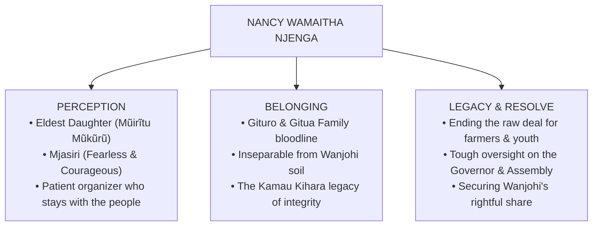

# CAMPAIGN BRAND STRATEGY: THE HERITAGE & CHARACTER OF WAMAITHA
## Candidate: Nancy Wamaitha Njenga
### Eldest Daughter of the Gituro / Gitua Family
### Target Seat: Member of County Assembly (MCA), Wanjohi Ward
### Constituency: Kipipiri | County: Nyandarua, Kenya

---

## 1. Heritage, Belonging & Legacy: The Gituro / Gitua Bloodline

In Wanjohi Ward and throughout Kipipiri, voter connection is forged on three sacred foundations: **Perception, Belonging, and Legacy**.

### The Power of the Eldest Daughter (*Mũirĩtu Mũkũrũ*)
Nancy Wamaitha is the **Eldest Daughter of the respected Gituro / Gitua family**, drawing deep inspiration from the pillar of **Kamau Kihara**. In Kikuyu culture, the eldest daughter carries a profound mandate:
- She is the first to shoulder responsibility when the family faces adversity.
- She is the protector of her younger siblings, ensuring no one goes hungry.
- She commands natural maternal authority, emotional maturity, and community respect.
- She does not run away when problems arise; she stays, solves them, and protects the homestead.

### The Archetype: **MJASIRI** (The Bold, Fearless Warrior)
Nancy Wamaitha is not timid. She is **Mjasiri**—a courageous woman who speaks truth to power. When cartels hijack county funds or brokers exploit farmers, she does not whisper in fear. She stands in the gap as the shield of Wanjohi.

---

## 2. The Unvarnished Truth: The Crises Facing Wanjohi Ward

Nancy Wamaitha’s candidacy is not born out of political ambition; it is born out of anger at the collapse of Wanjohi's core systems:

| Crisis Area | Ground Reality in Wanjohi Ward | Wamaitha's Mjasiri Legislative & Oversight Action |
| :--- | :--- | :--- |
| **1. Abandoned Youth & Dead Polytechnics** | - Local polytechnics have **no teachers, no equipment, and no budget**. - Desperate youth are left with no skills, drifting into illicit brew/drugs or breaking their backs in **quarry stone crushing** for survival. | - Push the County Assembly to revive and equip Wanjohi Vocational Centers with full-time accredited tutors. - Integrate polytechnic graduates directly into county public works contracts. |
| **2. Boda Boda in Crisis** | - Boda boda transport is dying under relentless **fuel price hikes**, harsh weather, and broken spare-parts costs. - Operators are abandoned after being used as campaign props. | - Build sheltered, solar-lit customer stages across all 22 centers. - Create a Ward Boda Boda SACCO support fund for group fuel purchasing and spare-part subsidies. |
| **3. The Dairy Heartbreak: Zero Milk Coolers** | - Wanjohi is a prime dairy production belt, yet **there are NO milk cooling plants (coolants) in the ward**. - Evening milk spoils or is sold at throwaway prices to predatory middlemen during road blockages. | - Fight for county budget allocation to install community milk cooling stations in Upper and Lower Wanjohi. - Revive cooperative bargaining power to negotiate fair farmgate prices. |
| **4. Collapsed Road Networks** | - Feeder roads are not roads—they are plowed red clay rivers during rains. Farm produce rots in the shamba. | - Direct deployment of county graders and culvert installations on critical farm-to-tarmac agricultural arteries. |
| **5. Understocked Dispensaries** | - Local health dispensaries lack basic essential drugs and laboratory reagents, forcing mothers to spend scarce money traveling to Ol Kalou. | - Sponsor legislation in the County Assembly holding the Governor and Health CEC accountable for uninterrupted drug supply chains. |
| **6. The Accountability Check** | - Wanjohi's share of devolved resources has been siphoned or diverted while previous leaders remained silent. | - **Zero compromise oversight:** Every devolved shilling allocated to Wanjohi Ward will be tracked, published, and accounted for. |

---

## 3. Core Slogans & Grassroots Chants

### The Official Campaign Creed:
> **"Wamaitha: Mũirĩtu Mũkũrũ wa Gituro, Mjasiri wa Wanjohi!"**  
> *(Wamaitha: Eldest Daughter of Gituro, The Fearless Champion of Wanjohi!)*

### The Accountability Slogan:
> **"Kazi na Haki • Rasilimali Zirudi Wanjohi!"**  
> *(Work and Justice • Return Resources to Wanjohi!)*

### The Grassroots Rally Call:
- **Leader:** *"Mũirĩtu wa Gituro?"* $\rightarrow$ **Crowd:** *"WAMAITHA!"*
- **Leader:** *"Mjasiri wa Wanjohi?"* $\rightarrow$ **Crowd:** *"WAMAITHA!"*
- **Leader:** *"Maziwa na Waru?"* $\rightarrow$ **Crowd:** *"BEI BORA!"*
- **Leader:** *"Wanjohi?"* $\rightarrow$ **Crowd:** *"KAZI NA HAKI!"*
