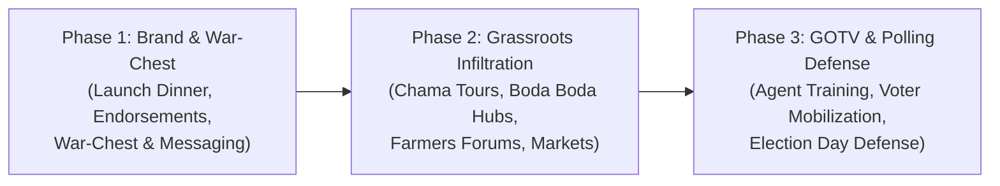

# WANJOHI WARD POLITICAL STRATEGY & WINNING ROADMAP
## Campaign of Nancy Wamaitha Njenga | MCA Wanjohi Ward
### Kipipiri Constituency, Nyandarua County

---

## 1. Ward Context & Political Landscape

- **Seat:** Member of County Assembly (MCA), Wanjohi Ward.
- **Constituency:** Kipipiri (Nyandarua County).
- **Core Economic Profile:** Farming (potatoes, cabbages, dairy, carrots, pyrethrum).
- **Voter Dynamics:**
  - High turnout among women, elders, and church congregants.
  - Youth (predominantly in transport/boda boda, small commerce, agricultural labor) are swing voters who demand active respect, jobs, and inclusion.
  - Diaspora / Nairobi-based Kipipiri professionals influence their parents and families back home with voting advice and campaign funding.

---

## 2. The 3-Phase Campaign Roadmap to Victory

### Phase 1: Brand Anchor & Capital Mobilization (Current Phase)
1. **The Campaign Launch Dinner:**
   - Anchor the political identity of **Nancy Wamaitha Njenga**.
   - Raise seed capital for campaign logistics, sound equipment, branded vehicle, merchandise (t-shirts, caps, scarves, fliers).
2. **Key Influencer Alignment:**
   - Quiet consultations with Church leaders (PCEA, Catholic, AIPCA, Full Gospel, etc.) across Wanjohi.
   - Engagement with council of elders (Kiama Kia Ma / Nyumba Kumi leaders) for cultural blessings.
3. **Diaspora & Professional Network:**
   - Establish the "Nairobi & Diaspora Friends of Wamaitha" group to sustain monthly campaign funding and strategic advisory.

### Phase 2: Ward Penetration & Cluster Engagement
1. **The "Wamaitha na Akorino & Chamas" Tour:**
   - Table banking meetings, merry-go-rounds, women church fellowships.
   - Agenda: Women's economic health, bursaries, maternity & child health in dispensaries.
2. **The "Boda Boda & Vijana na Wamaitha" Engagement:**
   - Town halls with youth riders and small traders in Wanjohi trading center, Ndunyu, and neighboring trading nodes.
   - Sponsoring a localized "Wamaitha Super Cup" football & netball tournament to unite the youth before major rallies.
3. **The Farmers' Town Halls:**
   - Direct dialogue on feeder roads impassability during rains and the exploitation of potato packaging.
   - Position Wamaitha as the boldest oversight voice to champion Nyandarua potato farmers in Ol Kalou assembly.

### Phase 3: The Ground Game & Election Day Defense (GOTV)
1. **Polling Station Captains:**
   - Appoint 2 trusted agents (1 man, 1 woman) per polling station across Wanjohi Ward.
   - Ensure thorough training on electoral laws, tally sheet verification, and immediate photo transmission of Form 36A/34A.
2. **Voter Mobilization Teams:**
   - Special vehicle mobilization for the elderly and disabled on voting day morning.
   - Early morning whistle squads (*Kuamsha Kura*) to ensure 85%+ turnout in stronghold centers.
