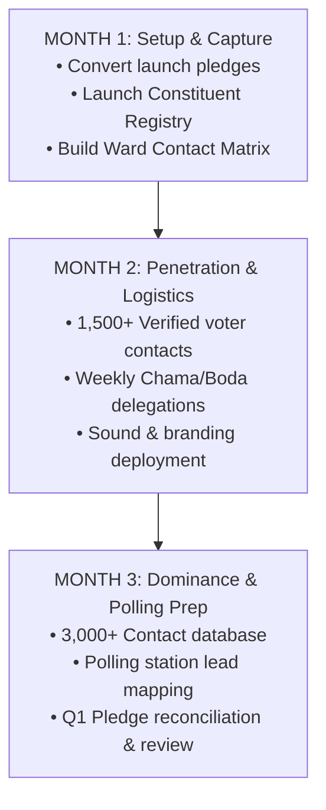

# FRONT OFFICE OPERATIONAL PLAYBOOK: 3-MONTH MICRO-GOALS
## Campaign of Nancy Wamaitha Njenga | MCA Wanjohi Ward (Kipipiri, Nyandarua)
### Desk: Campaign Front Office & Operations Lead

---

## Front Office Mission Statement
The Front Office is the engine room of the campaign. Its mission is to transform the excitement of the launch dinner into **hard voter data, converted cash, synchronized candidate movements, and relentless village-level goodwill**.

---

## 3-Month Micro-Goal Architecture (90-Day Sprint)

---

## MONTH 1: Setup, Pledge Conversion & Constituent Registry (Days 1 – 30)

### Focus: Locking in starting funds, setting up the visitor desk, and mapping village influencers.

| Micro-Goal Area | Specific Front Office Action | Measurable Outcome (Target KPI) |
| :--- | :--- | :--- |
| **1. Dinner Pledge Conversion** | - Follow up every pledge card from the launch dinner via personal calls and WhatsApp within 72 hours. - Issue formal digital receipts and maintain payment tracker. | **Target: ≥ 70% of dinner pledges collected in cash/M-Pesa within 21 days.** |
| **2. Front Office Walk-in Desk** | - Open the dedicated physical desk/office (or mobile command hub). - Institute the **Daily Visitor Logbook** (Name, Polling Station/Village, Phone, Issue/Request, Follow-up status). | **Target: 100% of all visitors logged; 0 unrecorded walk-ins.** |
| **3. Ward Opinion Leader Matrix** | - Map and profile the key influencers in Wanjohi Ward (pastors, priests, chama chairladies, boda boda stage chairmen, elders). | **Target: Minimum 100 verified key contacts mapped across all Wanjohi sub-locations.** |
| **4. Candidate Weekly Calendar** | - Institute a rolling 7-day diary for Nancy Wamaitha (Church Sundays, Chama Tuesdays/Thursdays, Market Saturdays, Village Walkabouts). | **Target: 0 missed diary appointments; candidate briefed 24 hrs prior.** |
| **5. Daily 15-Minute Debrief** | - Hold a mandatory 15-minute 6:00 PM evening alignment with Nancy Wamaitha: visitors received, intelligence picked up, pending actions. | **Target: 100% daily compliance on weekdays.** |

---

## MONTH 2: Field Infiltration, Mobilization & Voter Data Engine (Days 31 – 60)

### Focus: Bringing Wanjohi grassroots delegations to the front office and multiplying voter contacts.

| Micro-Goal Area | Specific Front Office Action | Measurable Outcome (Target KPI) |
| :--- | :--- | :--- |
| **1. Grassroots Delegation Desk** | - Schedule and host structured mini-delegations at the front office (e.g., 5–10 representatives per session: women chamas, boda boda stage reps, potato farmers). | **Target: Host at least 3 delegations per week (min. 12 delegations / ~120 leaders in Month 2).** |
| **2. Voter Contact Database (CRM)** | - Capture and verify voter contacts into an Excel/Google Sheets Campaign Database categorized by polling station and village. | **Target: 1,500 verified Wanjohi registered voter phone numbers in the database.** |
| **3. Ground Logistics & Collateral** | - Front Office distribution control of campaign materials (branded reflector jackets to boda riders, flyers, badges, banners). - Maintain strict inventory control (who received what, phone number, village). | **Target: 100% tracked inventory; 500+ boda boda reflectors and 2,000 flyers distributed and logged.** |
| **4. Sustained Micro-Fundraising** | - Launch the "Friends of Wamaitha 100-Bob Monthly Club" targeting diaspora and grassroots supporters via Paybill. | **Target: Minimum 200 active recurring contributors; KES 50,000+ raised in Month 2.** |
| **5. Grievance & Intelligence Log** | - Track rumors, opponent propaganda, and community grievances across Wanjohi villages; draft immediate counter-talking points for Nancy. | **Target: Rapid response within 12 hours of emerging ward rumors/issues.** |

---

## MONTH 3: Consolidation, Polling Center Mapping & Ground Dominance (Days 61 – 90)

### Focus: Securing polling station presence, expanding voter reach, and auditing quarter performance.

| Micro-Goal Area | Specific Front Office Action | Measurable Outcome (Target KPI) |
| :--- | :--- | :--- |
| **1. Polling Station Agent Mapping** | - Identify and vet 2 potential frontline polling agents (1 youth/man, 1 woman) for every registered polling station in Wanjohi Ward. | **Target: 100% of all Wanjohi polling stations have vetted point-persons mapped.** |
| **2. Database Expansion to 3,000+** | - Accelerate voter data collection through candidate ground tours, town halls, and church events. | **Target: Reach 3,000+ verified registered voter contacts.** |
| **3. Bulk SMS & Direct Communication** | - Execute the first ward-wide segmented Bulk SMS blast from the Front Office (targeted messages for farmers, youth, and women). | **Target: 95%+ delivery rate across 3,000 contacts; cost < KES 0.50 per SMS.** |
| **4. Quarterly Financial & Operational Audit** | - Complete a full reconciliation of all funds raised vs operational expenditure (fuel, logistics, print, delegations). - Present Quarter 1 performance report to Nancy Wamaitha and the Patrons Committee. | **Target: 100% reconciled accounts; zero unvouched petty cash expenditures.** |
| **5. Strategic Review & Q2 Plan** | - Hold a 1-day retreat with Nancy Wamaitha to review polling station strengths/weaknesses and set Q2 campaign goals. | **Target: Q2 Operational Blueprint signed off by Day 90.** |

---

## Front Office Daily Routine & Operational Tools

### Daily Front Office Rhythm:
* **8:00 AM – 8:30 AM:** Desk opening, review daily appointments, check overnight messages/M-Pesa alerts.
* **8:30 AM – 1:00 PM:** Receiving grassroots walk-ins, constituent delegation meetings, recording voter contacts.
* **1:00 PM – 2:00 PM:** Logistics coordination (materials, vehicle prep, campaign print stock).
* **2:00 PM – 5:30 PM:** Phone calls (pledge collection, following up village contact leads, verifying polling lists).
* **5:30 PM – 6:00 PM:** Daily closing reconciliations (cash log, visitor log, database entries).
* **6:00 PM – 6:15 PM:** Mandatory 15-minute briefing with Nancy Wamaitha.

### Essential Front Office Tracking Registers:
1. **Visitor & Delegation Logbook** (`Date | Name | Village | Phone | Polling Station | Agenda | Action Taken`)
2. **Pledge & Finance Tracker** (`Pledger | Tier | Amount Pledged | Paid To Date | Balance | Follow-up Date`)
3. **Voter Contact Matrix** (`Name | Gender | Age Bracket | Village | Polling Center | Occupation | Stance: Supporter/Undecided`)
4. **Candidate Movement Tracker** (`Date | Location | Host/Contact Person | Target Group | Attendance Estimate | Key Issues Raised`)
