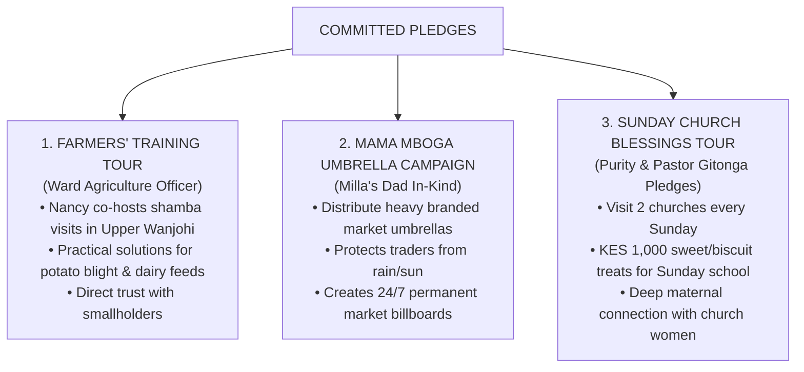

# FRONT OFFICE FINANCIAL LEDGER & OPERATIONAL BUDGET
## Campaign of Nancy Wamaitha Njenga | MCA Wanjohi Ward (Kipipiri, Nyandarua)
### Managed by: Front Office & Campaign Operations Desk

---

## 1. Official Pledges & Committed Seed Capital Ledger

This ledger tracks all confirmed launch commitments—both direct funding and strategic in-kind contributions.

| Contributor / Family | Commitment Type | Value / Contribution Details | Operational Deployment & Status |
| :--- | :--- | :--- | :--- |
| **Joe’s Family** | Ongoing Cash (Monthly) | **KES 40,000 per month** *(All through the campaign)* | **Core Ground Logistics Anchor:** Fuels candidate movement, sound system, and village travel. |
| **Strategist & Dad** | Seed Cash | **KES 40,000** | Campaign strategy, front office setup, and operational coordination. |
| **Mwaura’s Family** | In-Kind / Cash | **KES 10,000** | Dedicated Tuk Tuk route branding & Paybill promotion banners. |
| **Pastor Gitonga** | Cash Pledge | **KES 5,000** | Clergy blessings and church outreach facilitation. |
| **Purity** | Cash Pledge | **KES 3,000** | Children's Sunday welfare treats & mothers' outreach. |
| **Ward Agriculture Officer** | In-Kind + Cash | **KES 1,250 + Transport for Upper Wanjohi** | **Strategic Ground Breakthrough:** Direct access to co-host farmer training sessions in Upper Wanjohi (potatoes & dairy). |
| **Milla’s Dad** | High-Impact In-Kind | **Mama Mboga Umbrellas** | Branded large market umbrellas distributed to vegetable traders in Wanjohi, Ndunyu, and Rironi centers (permanent daily billboards). |
| **Victor Njoroge** | In-Kind Print | **100 Heavy Full-Color Posters** | Strategic placement at main trading centers and bus stops. |
| **Victor Magu** | In-Kind Print | **100 Heavy Full-Color Posters** | Wall branding along main transport corridors. |

---

## 2. Front Office Forward Operational Budget & Procurement Needs

The following items represent the immediate operational bills and weekly running costs required to establish ground dominance across all 22 Polling Centers:

### A. Core Branding & Visible Collateral
| Item Description | Quantity / Volume | Unit Cost (Est.) | Total Budget (KES) | Strategic Purpose |
| :--- | :---: | :---: | :---: | :--- |
| **B5 Campaign Stickers** | 1,000 pcs | KES 15 | **KES 15,000** | Boda boda fuel tanks, shop windows, milk cans, private cars. |
| **Wall Calendars (High Household Longevity)** | 1,000 pcs | KES 45 | **KES 45,000** | Hung inside living rooms for the full year—constant daily reminder in voter homes. |
| **Matatu & Tuk Tuk Route Branding** | 50 Vehicles | KES 500 | **KES 25,000** | Mobile billboards plying the Ol Kalou – Wanjohi – Engineer routes. |
| **Small Pocket Flyers / Manifesto Leaflets** | 3,000 pcs | KES 4 | **KES 12,000** | Distributed during church and market walkabouts. |
| **SUBTOTAL (Branding Assets)** | | | **KES 97,000** | |

### B. Weekly Running Operations (Operational Cash Flow)
| Operational Activity | Frequency | Unit Rate | Monthly Total (KES) | Front Office Notes |
| :--- | :---: | :---: | :---: | :--- |
| **Field Logistics & Fuel** | Weekly | KES 7,500 / week | **KES 30,000** | Covered comfortably by **Joe’s Family anchor pledge (KES 40,000/mo)**. |
| **Sunday Church Children’s Treats** | Weekly | 2 Churches @ KES 1,000 | **KES 8,000** | (KES 2,000/week) High emotional goodwill with Sunday schools & mothers. |
| **Digital, Social Media & Local Bloggers** | Monthly | Lump Sum | **KES 5,000** | Narrative defense, photo reels, WhatsApp updates to Kipipiri groups. |
| **Targeted Bulk SMS Broadcasts** | Monthly | Lump Sum | **KES 5,000** | Ward-wide direct SMS to farmers, youth, and church leaders. |
| **SUBTOTAL (Monthly Operations)** | | | **KES 48,000 / month** | |

---

## 3. High-Impact Grassroots Engagement Activities

The Front Office will execute three distinct ground connection initiatives powered by the pledges:

### Initiative 1: The Upper Wanjohi Farmer Extension Tour
* **Partner:** Local Ward Agriculture Officer (Transport + KES 1,250 provided).
* **Execution:** Nancy accompanies the officer on agricultural training field-days in Upper Wanjohi (Michore, Huhirio, Mwireri, Gatondo).
* **The Message:** Nancy does not just promise agricultural reform; she stands in the shamba with the farmers and the extension officer, addressing potato packaging and dairy feed costs directly.

### Initiative 2: The Mama Mboga Umbrellas (The Living Billboard)
* **Partner:** Milla’s Dad pledge.
* **Execution:** Assemble 30–50 heavy-duty outdoor market umbrellas branded:  
  * **"Simama na Wamaitha • Kazi na Haki • Mũirĩtu wa Tiri"**
* **Placement:** Gifted to prominent vegetable and potato traders in Wanjohi open-air market, Ndunyu, and Rironi shopping centers.
* **Impact:** Protects mothers from harsh Aberdare rain and sun while providing unmissable, continuous brand visibility in the busiest hubs of the ward.

### Initiative 3: The Sunday Church Children’s Fellowship
* **Budget:** KES 2,000 per Sunday (2 Churches @ KES 1,000 for sweets, biscuits, fruit treats).
* **Execution:** Candidate attends morning service, greeted by pastor/clergy, and presents simple treats to the Sunday School children outside after service.
* **Impact:** In rural Nyandarua, the way to a mother’s vote is through the happiness and dignity of her children.
