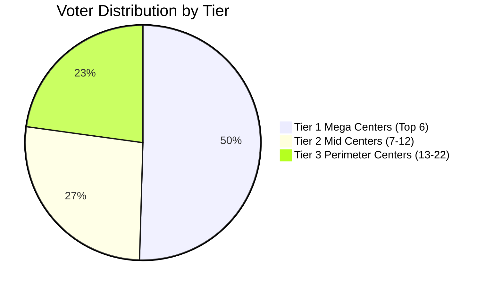
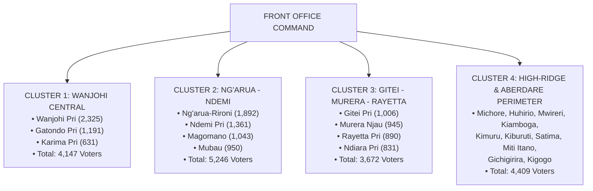

# WANJOHI WARD: ELECTORAL MATHEMATICS, POLLING STRATEGY & FRONT OFFICE TARGETS
## Candidate: Nancy Wamaitha Njenga | MCA Wanjohi Ward (Kipipiri, Nyandarua)
### Official IEBC Polling Data: 17,474 Registered Voters | 22 Polling Centers | 35 Polling Stations (Streams)

---

## 1. The Electoral Mathematics: The "Magic Number" to Win Wanjohi

In a typical General Election in Nyandarua County, voter turnout averages **70% to 75%**.

```
Total Registered Voters:    17,474
Expected Voter Turnout (75%): ~13,105 votes cast
Expected Valid Votes:         ~12,850 votes
```

### The Winning Formula:
In a typical MCA contest with 4 to 6 contenders:
- A candidate who secures **45% to 50%** of the valid votes wins decisively.
- **The Magic Winning Target for Nancy Wamaitha: 6,000 – 6,500 VOTES.**
- If Wamaitha secures **6,200 votes**, no opponent can catch her.

---

## 2. Polling Center Tier Analysis: The 80/20 Rule

The 22 polling centers naturally break down into 3 critical tiers. This determines where the Front Office must concentrate its resources, delegations, and volunteer manpower.



### TIER 1: The "Mega 6" Kingmaker Centers (50.5% of the Ward)
These 6 centers control **8,818 votes**. You cannot win Wanjohi Ward without commanding this tier.

| Rank | Polling Center Name | Registered Voters | Streams (Stations) | Front Office Win Target (Votes) |
| :---: | :--- | :---: | :---: | :---: |
| 1 | **WANJOHI PRIMARY SCHOOL** | 2,325 | 4 | **1,200** |
| 2 | **NG'ARUA-RIRONI PRIMARY SCHOOL** | 1,892 | 3 | **950** |
| 3 | **NDEMI PRIMARY SCHOOL** | 1,361 | 2 | **650** |
| 4 | **GATONDO PRIMARY SCHOOL** | 1,191 | 2 | **550** |
| 5 | **MAGOMANO PRIMARY SCHOOL** | 1,043 | 2 | **500** |
| 6 | **GITEI PRIMARY SCHOOL** | 1,006 | 2 | **480** |
| **SUBTOTAL** | **TIER 1 (6 Centers)** | **8,818** | **15** | **4,330** |

*Strategic Note:* Securing **4,330 votes** from Tier 1 alone achieves **~70%** of the total winning target of 6,200 votes!

---

### TIER 2: The "Battleground 6" Mid-Tier Centers (26.7% of the Ward)
These 6 centers control **4,668 votes**. This is where races are defended and opponents are suppressed.

| Rank | Polling Center Name | Registered Voters | Streams (Stations) | Front Office Win Target (Votes) |
| :---: | :--- | :---: | :---: | :---: |
| 7 | **MUBAU PRIMARY SCHOOL** | 950 | 2 | **400** |
| 8 | **MURERA NJAU PRIMARY SCHOOL** | 945 | 2 | **400** |
| 9 | **RAYETTA PRIMARY SCHOOL** | 890 | 2 | **380** |
| 10 | **NDIARA PRIMARY SCHOOL** | 831 | 2 | **350** |
| 11 | **MICHORE PRIMARY SCHOOL** | 651 | 1 | **280** |
| 12 | **KARIMA PRIMARY SCHOOL** | 631 | 1 | **270** |
| **SUBTOTAL** | **TIER 2 (6 Centers)** | **4,668** | **10** | **2,080** |

---

### TIER 3: The "Perimeter 10" Centers (22.8% of the Ward)
These 10 smaller centers control **3,988 votes**. They border the ridges, forest edges, and outer zones. They must not be conceded to opponents.

| Rank | Polling Center Name | Registered Voters | Streams (Stations) | Front Office Win Target (Votes) |
| :---: | :--- | :---: | :---: | :---: |
| 13 | **HUHIRIO PRIMARY SCHOOL** | 600 | 1 | **220** |
| 14 | **MWIRERI PRIMARY SCHOOL** | 515 | 1 | **200** |
| 15 | **KIAMBOGA PRIMARY SCHOOL** | 514 | 1 | **200** |
| 16 | **KIMURU PRIMARY SCHOOL** | 435 | 1 | **170** |
| 17 | **KIBURUTI PRIMARY SCHOOL** | 399 | 1 | **150** |
| 18 | **SATIMA PRIMARY SCHOOL** | 371 | 1 | **140** |
| 19 | **MITI ITANO PRIMARY SCHOOL** | 363 | 1 | **140** |
| 20 | **GICHIGIRIRA PRIMARY SCHOOL** | 358 | 1 | **130** |
| 21 | **HUHIRIO-B ECD** | 162 | 1 | **60** |
| 22 | **KIGOGO PRIMARY SCHOOL** | 41 | 1 | **20** |
| **SUBTOTAL** | **TIER 3 (10 Centers)** | **3,988** | **10** | **1,430** |

---

### SUMMARY OF TOTAL VOTE HARVEST TARGETS:
* **Tier 1 (Top 6 Mega Centers):** 4,330 votes
* **Tier 2 (6 Mid Centers):** 2,080 votes
* **Tier 3 (10 Perimeter Centers):** 1,430 votes
* **TOTAL HARVEST POTENTIAL:** **7,840 VOTES** *(Safe buffer above the 6,200 winning threshold)*

---

## 3. Four Front Office Operational Clusters

To manage grassroots operations effectively without getting overwhelmed by 22 separate centers, the Front Office should organize Wanjohi Ward into **4 Geographic Zones/Clusters**:



---

## 4. Front Office Micro-Goals Mapped to Polling Stations (Quarter 1 Sprint)

With 35 distinct Polling Stations (streams) across 22 centers, the Front Office manager now has exact measurable quotas for the 3-month plan:

### Micro-Goal 1: Polling Station Agent Mapping (Day 1 – Day 60)
* **Metric:** Recruit and vet **2 Agents per polling stream** (1 Chief Agent + 1 Reliever/Mobilizer) = **70 Polling Station Agents in total**.
* **Gender/Age Quota per Station:** Exactly 1 youth/man and 1 woman per station.
* **Timeline:**
  * Month 1: Complete 30 agents for Tier 1 Mega Centers (15 streams).
  * Month 2: Complete 20 agents for Tier 2 Centers (10 streams).
  * Month 3: Complete 20 agents for Tier 3 Perimeter Centers (10 streams).

### Micro-Goal 2: Contact Acquisition Quotas by Center (Day 1 – Day 90)
To reach the front office target of **3,000+ verified voter contacts**:
* **Wanjohi Primary:** 400 voter contacts logged.
* **Ng'arua-Rironi:** 350 voter contacts logged.
* **Ndemi Primary:** 250 voter contacts logged.
* **Gatondo Primary:** 200 voter contacts logged.
* **Magomano & Gitei:** 180 contacts each (= 360).
* **Mubau, Murera Njau, Rayetta, Ndiara:** 150 contacts each (= 600).
* **Remaining 12 Centers:** ~70 contacts each (= 840).
* **TOTAL FRONT OFFICE CRM DATABASE:** **3,000 VERIFIED CONTACTS.**

### Micro-Goal 3: Front Office Delegation Schedule
Instead of random visitors, invite **1 structured delegation per Polling Center** to meet Nancy Wamaitha:
* **Weeks 1–4:** Host delegations from the Big 6 Centers (Wanjohi, Ng'arua-Rironi, Ndemi, Gatondo, Magomano, Gitei).
* **Weeks 5–8:** Host delegations from the Mid-Tier Centers (Mubau, Murera, Rayetta, Ndiara, Michore, Karima).
* **Weeks 9–12:** Host delegations from the Perimeter Centers (Huhirio, Mwireri, Kiamboga, Satima, etc.).
